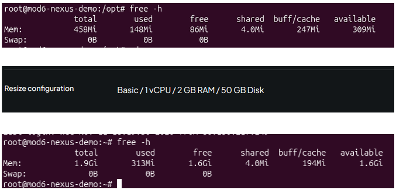
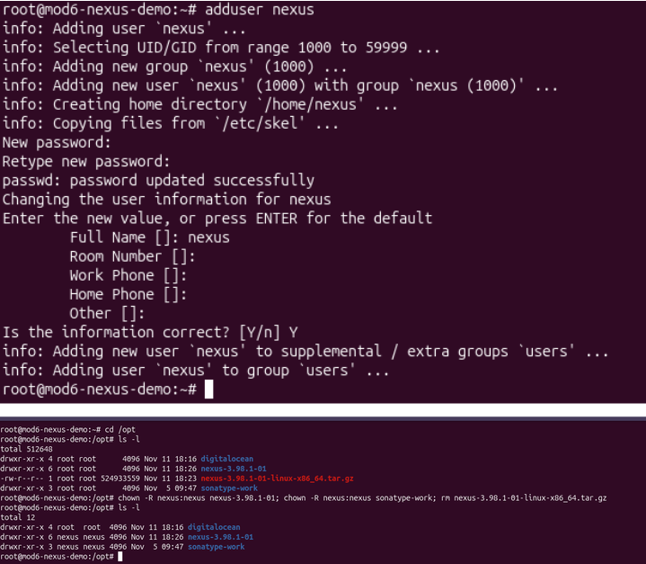
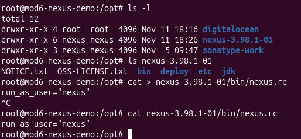
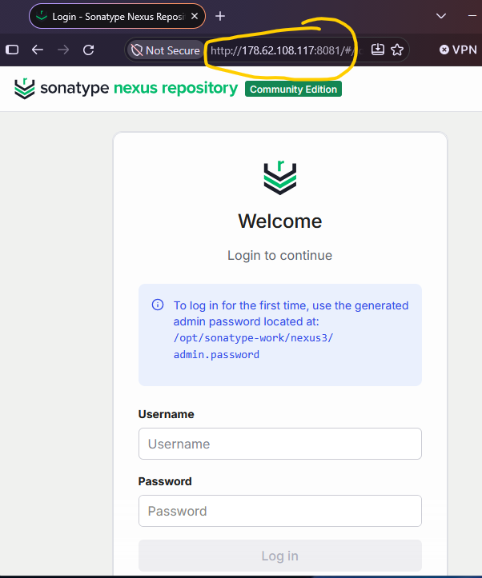
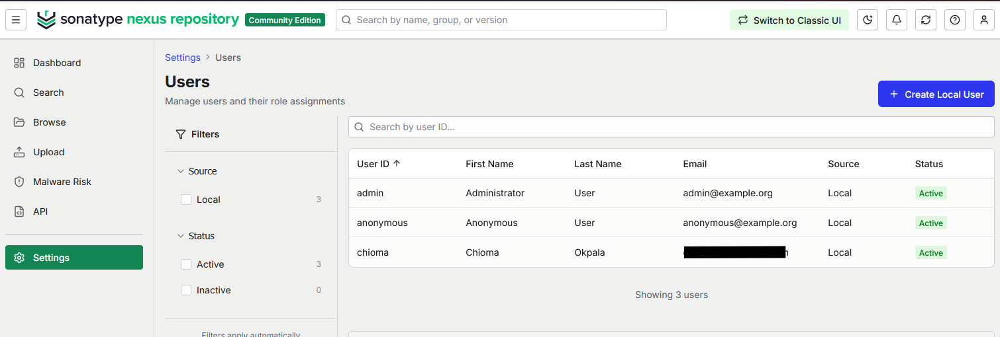
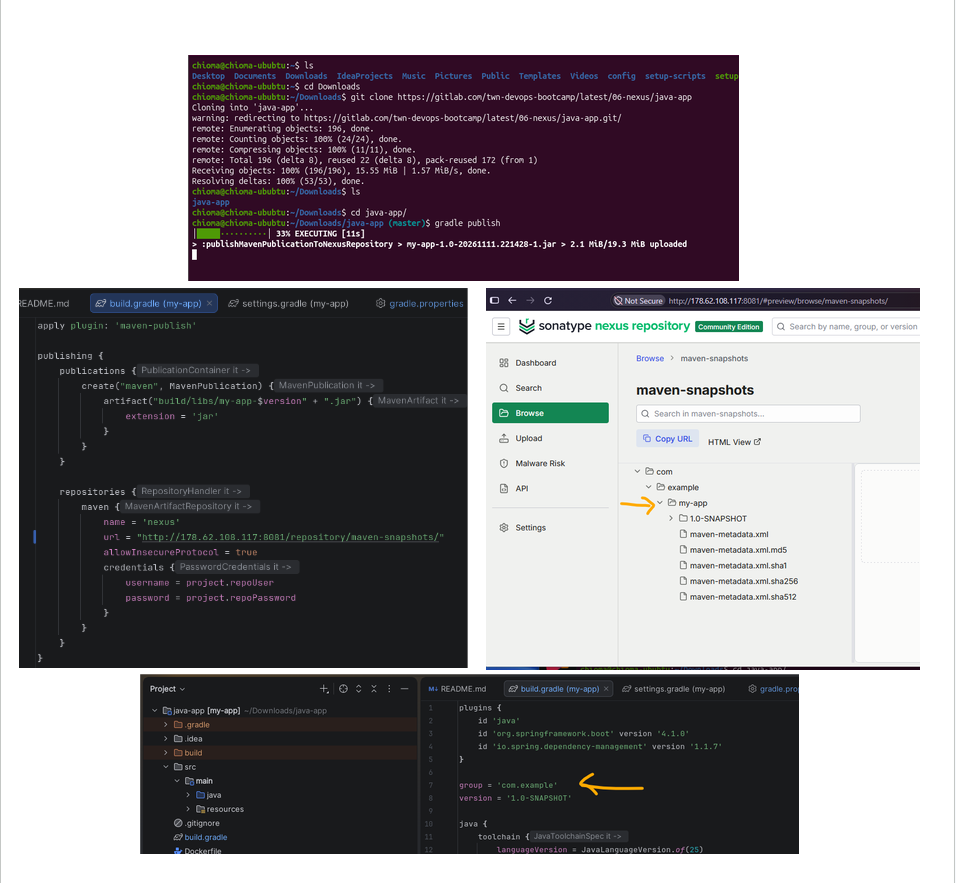
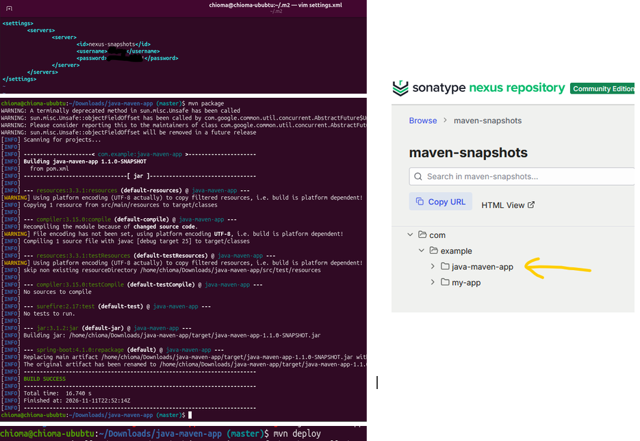

# Artifact Repository Management & Java Artifact Publishing with Nexus

Provisioning and configuring Sonatype Nexus Repository Manager on a Linux cloud server, with artifact publishing workflows for Java applications built using Gradle and Maven.

---

## Overview

This project demonstrates the implementation of a centralised artifact repository using Sonatype Nexus Repository Manager on a DigitalOcean Ubuntu server.

The objective was to install and configure Nexus, establish appropriate service and repository-level access controls, and publish Java application artifacts from local development environments to a hosted Maven repository.

The implementation also involved troubleshooting cloud resource limitations, configuring Linux filesystem permissions, understanding Nexus application and data storage, and integrating both Gradle and Maven with Nexus.

---

## Tech Stack

| Technology | Purpose |
|---|---|
| DigitalOcean | Cloud server provisioning and hosting |
| Ubuntu Linux | Nexus server operating system |
| Sonatype Nexus Repository Manager 3 | Artifact repository management |
| Java | Nexus and Java application runtime |
| Gradle | Build and publish Java artifacts |
| Maven | Build and deploy Java artifacts |
| SSH | Remote Linux server administration |
| Linux users and permissions | Service isolation and filesystem access control |
| DigitalOcean Cloud Firewall | Network access to the Nexus interface |

---

## Implementation Scope

- Provisioned an Ubuntu Droplet and configured cloud firewall access.
- Investigated resource limitations and resized the Droplet to support Nexus.
- Downloaded and extracted Nexus Repository Manager under `/opt`.
- Examined the separation between Nexus application binaries and persistent repository data.
- Installed the required Java runtime.
- Created a dedicated Linux service account for Nexus.
- Configured ownership of Nexus application and data directories.
- Configured `nexus.rc` to run Nexus under the dedicated service account.
- Started Nexus and verified the application process and listening port.
- Configured browser access to the Nexus management interface.
- Completed initial Nexus administrative setup.
- Created a Nexus repository user with artifact-publishing permissions.
- Configured Gradle and Maven projects to publish artifacts to Nexus.
- Verified published artifacts in the hosted `maven-snapshots` repository.

---

## Architecture & Artifact Publishing Workflow

```text
                    LOCAL DEVELOPMENT ENVIRONMENT
                    -----------------------------

        Java Gradle Project        Java Maven Project
                 |                         |
                 v                         v
           gradle build                mvn package
                 |                         |
                 v                         v
             JAR Artifact             JAR Artifact
                 |                         |
           gradle publish                mvn deploy
                 |                         |
                 +------------+------------+
                              |
                              | HTTP artifact publishing
                              | Repository URL + credentials
                              v
                  DIGITALOCEAN UBUNTU DROPLET
                  ----------------------------

                     Nexus Repository Manager
                              |
                              v
                   Hosted Maven Repository
                       maven-snapshots
                              |
                              v
                    Published Java Artifacts
```

Nexus runs on the cloud server under a dedicated Linux service account. Gradle and Maven publish artifacts remotely using credentials belonging to a separate user configured within Nexus Repository Manager.

---

# Implementation Walkthrough

### 01 — Provision the Cloud Server

An Ubuntu Droplet was initially provisioned on DigitalOcean using a minimal configuration of 1 vCPU and 512 MB RAM to reduce infrastructure costs during the exercise.

Existing cloud firewall rules were associated with the Droplet, and SSH was used to connect from the local Ubuntu terminal.

The Nexus installation archive was downloaded from Sonatype using `wget`, then extracted under `/opt`.

The `/opt` directory was used to organise the third-party application installation, although Linux does not strictly require Nexus to be installed in that location.

**Outcome:** The initial Ubuntu server was provisioned and the Nexus installation files were downloaded and extracted.

---

### 02 — Investigate Resource Constraints and Resize the Droplet

The initial 512 MB RAM configuration proved insufficient for the Nexus workload.

During package management and server preparation, low-memory conditions became apparent.

The following commands were used to investigate resource availability and filesystem consumption:

```bash
free -h
du -sh /opt/*
df -h
```

These commands examine different resources:

- `free -h` reports system memory and swap usage.
- `du -sh /opt/*` reports disk space consumed by files and directories under `/opt`.
- `df -h` reports filesystem capacity and available disk space.

The Nexus installation occupied a substantial amount of disk space, while the server had very limited available memory for running Nexus and its supporting processes.

The Droplet was subsequently resized to **1 vCPU and 2 GB RAM**, providing more suitable resources for the learning exercise.

#### Deployment Evidence — Resource Investigation



**Outcome:** The cloud environment was adjusted after identifying that the initial resource allocation was unsuitable for Nexus.

---

### 03 — Understand Nexus Application and Data Directories

After extracting the Nexus archive, two principal directories were identified:

**Nexus application directory**

Contains the Nexus application binaries, startup scripts, libraries and runtime-related files.

**Sonatype work directory**

Contains persistent Nexus data, including repository content, configuration-related data, logs and metadata.

This separation is important because the application installation and persistent repository data have different lifecycles.

During a properly planned upgrade, application binaries may be replaced while persistent data is preserved, subject to the relevant Nexus version's upgrade and migration requirements.

The Nexus installation is configured to locate its work directory through the applicable runtime configuration.

**Key learning:** Artifact repository management involves both the application runtime and persistent storage. Backups must protect the actual repository data, not merely the Nexus executable files.

---

### 04 — Install Java and Configure a Dedicated Linux Service Account

The required Java runtime was installed on the Ubuntu server.

A dedicated Linux user named `nexus` was created to avoid running the application routinely as root.

```bash
sudo adduser nexus
```

Ownership of the Nexus application and work directories was then assigned to the service account.

The `chown` command was used recursively to ensure that the service user could access the necessary files and directories.

#### Deployment Evidence — Linux Service User



**Outcome:** Nexus application files and persistent data were configured for access by the dedicated Linux service account.

---

### 05 — Configure Nexus Runtime Identity

The Nexus startup configuration was updated through the `nexus.rc` file inside the application's `bin` directory.

The configuration specified the Linux user under which the Nexus startup script should run:

```bash
run_as_user="nexus"
```

This setting controls the runtime identity used by the Nexus startup mechanism.

It does not create the Linux account or independently assign filesystem permissions. Those operations must be performed separately.

#### Deployment Evidence — Nexus Runtime Configuration



**Outcome:** The Nexus startup configuration was set to use the dedicated Linux service account.

---

### 06 — Start Nexus and Configure Administrative Access

The Nexus application was started using its startup script.

Process inspection was used to check whether the application had started and to identify its process ID.

```bash
ps aux
```

Network-listening checks were also performed to identify the port used by the Nexus application.

Nexus was configured for access through TCP port `8081`.

The DigitalOcean firewall was updated to permit the required inbound traffic for the exercise.

The Nexus web interface was then accessed through a browser.

During the initial setup, the automatically generated administrator password was retrieved from the server and replaced through the Nexus setup process.

#### Deployment Evidence — Nexus Startup and Web Interface



**Outcome:** Nexus Repository Manager was running on the cloud server and accessible through its management interface.

---

### 07 — Configure Nexus Repository Permissions

A separate user was created within the Nexus web interface to publish Java artifacts.

The account was configured under:

`Settings → Security → Users`

A role named `nx-java` was created and assigned to the publishing user.

This separated administrative access to Nexus from the credentials used by build tools to upload artifacts.

#### Deployment Evidence — Repository User Configuration



**Outcome:** A Nexus application-level identity was available for authenticated artifact publishing.

---

### 08 — Publish a Java Artifact Using Gradle

The Java Gradle application was cloned into the local development environment.

Its `build.gradle` configuration was used to enable artifact publishing through the Gradle `maven-publish` plugin.

A simplified example of the relevant configuration is:

```groovy
plugins {
    id 'maven-publish'
}

publishing {
    publications {
        maven(MavenPublication) {
            artifact("build/libs/my-app.jar") {
                extension = 'jar'
            }
        }
    }

    repositories {
        maven {
            url = uri("http://NEXUS_HOST:8081/repository/maven-snapshots/")
            allowInsecureProtocol = true
            credentials {
                username = project.repoUser
                password = project.repoPassword
            }
        }
    }
}
```

This is an illustrative version of the publishing configuration. Artifact names, project properties and repository addresses must match the actual project.

The Nexus publishing credentials were configured locally using Gradle properties and were not intended to be committed to a public repository.

The application was built using:

```bash
gradle build
```

The artifact was then published using:

```bash
gradle publish
```

The publishing task uploaded the configured artifact and Maven metadata to the Nexus hosted repository.

#### Deployment Evidence — Gradle Artifact Publishing



**Outcome:** The Gradle-built Java artifact was published successfully to Nexus and verified through the repository browser.

---

### 09 — Publish a Java Artifact Using Maven

A separate Java Maven application was cloned locally.

The project's `pom.xml` contained configuration for artifact deployment, including the Maven Deploy Plugin and the destination repository.

The `distributionManagement` section identified the hosted Nexus repository to receive the published artifact.

For example:

```xml
<distributionManagement>
    <snapshotRepository>
        <id>nexus-snapshots</id>
        <url>http://NEXUS_HOST:8081/repository/maven-snapshots/</url>
    </snapshotRepository>
</distributionManagement>
```

The corresponding Nexus credentials were configured in the local Maven settings file:

`~/.m2/settings.xml`

The `<server>` identifier in that file must match the repository identifier specified in the POM.

The Maven project was packaged using:

```bash
mvn package
```

The generated JAR was verified under the project's `target/` directory.

The artifact was then deployed using:

```bash
mvn deploy
```

#### Deployment Evidence — Maven Artifact Publishing



**Outcome:** The Maven-built Java artifact was published successfully to Nexus.

---

### 10 — Verify Both Published Artifacts

The Nexus repository browser was used to inspect the `maven-snapshots` hosted repository.

Both the Gradle and Maven application artifacts were visible in the repository hierarchy.

The repository contained published artifact files and associated Maven metadata.

This confirmed that both build tools could communicate with the remote Nexus repository and publish their outputs using configured repository destinations and credentials.

**Outcome:** The same central artifact repository successfully received artifacts from two different Java build tools.

---

## Important Distinction: Linux Service User vs Nexus Repository User

Two different identities were used during this project.

| | Linux service user | Nexus repository user |
|---|---|---|
| Created where? | Ubuntu server | Nexus web interface |
| Managed by | Linux operating system | Nexus Repository Manager |
| Purpose | Run the Nexus application process | Authenticate to Nexus and publish artifacts |
| Example | `nexus` | Dedicated artifact publisher |
| Used through | Server terminal / service startup | Gradle, Maven, Nexus API or web UI |
| Permissions | Linux filesystem and process permissions | Nexus repository roles and privileges |

**Key learning:** Running Nexus and publishing artifacts to Nexus are separate operations requiring different identities and permissions.

The Nexus service account operates on the Ubuntu server. The repository publishing account authenticates to the Nexus application remotely.

---

## Troubleshooting & Lessons Learned

### 01 — Cloud Resource Sizing

**Issue:** The initial 512 MB RAM Droplet was inadequate for Nexus.

**Investigation:** Examined memory availability and filesystem usage, identifying the limitations of the initial server configuration.

**Resolution:** Resized the Droplet to 2 GB RAM.

**Learning:** Infrastructure cost optimisation must be balanced against the actual resource requirements of the application workload.

---

### 02 — Application Binaries vs Persistent Repository Data

**Learning:** Nexus application binaries and persistent repository data are stored separately.

This distinction matters for application upgrades, backup planning, recovery and storage management.

---

### 03 — Linux Service Accounts vs Application-Level Accounts

**Challenge:** Understanding why a Linux user and a Nexus UI user were both needed.

**Learning:** Linux controls the identity under which the Nexus process runs, while Nexus controls who can authenticate to the repository manager and what actions they can perform.

These identities operate at different layers.

---

### 04 — Gradle Artifact Publishing

**Learning:** The `maven-publish` plugin provides Gradle publishing capabilities. The `publishing` configuration specifies the publication, target repository and authentication details.

The `publish` task performs the publication.

---

### 05 — Maven Artifact Deployment

**Learning:** Maven uses project metadata and deployment configuration in `pom.xml` to identify the artifact and destination repository.

The Maven Deploy Plugin performs deployment, while Maven settings provide credentials for the configured repository.

---

### 06 — Artifact Repositories vs Source Code Repositories

**Learning:** Git repositories store and version source code, whereas Nexus stores packaged build outputs and associated metadata.

A central artifact repository allows built application packages to be stored and retrieved independently of their source code.

---

## Security Considerations

This project was performed in a temporary learning environment.

- Nexus was configured to run under a dedicated Linux service account.
- Artifact publishing used a separate Nexus application user rather than the administrator account.
- Repository access was controlled through Nexus roles and permissions.
- Publishing credentials should be excluded from Git commits and screenshots.
- The demonstration used HTTP access to the Nexus endpoint. HTTPS and further network hardening would be required for a production deployment.
- Exposing the Nexus management port publicly should be avoided in production unless access is appropriately restricted and protected.

---

## Technical Focus

### Cloud Infrastructure

- Server provisioning and capacity adjustment
- Resource troubleshooting
- Cloud networking and firewall configuration

### Linux Administration

- Service account creation
- Filesystem ownership and permissions
- Application runtime configuration
- Process and network-listening inspection

### Artifact Management

- Nexus installation and administration
- Hosted Maven repositories
- Repository users, roles and permissions
- Gradle and Maven artifact publication
- Artifact and metadata verification
